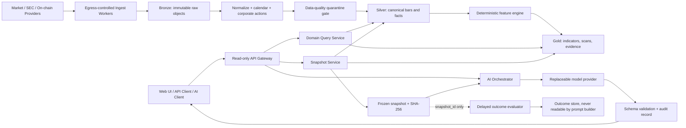

# 系统架构与数据流

## 1. 架构原则

基础版采用“模块化单体 API + 独立采集/计算 worker + PostgreSQL/TimescaleDB + Parquet 原始仓”的组合。这样可以保持一个事实引擎和清楚的模块边界，同时避免早期微服务带来的部署、事务和版本一致性负担。未来只有在吞吐、权限或团队边界证明有必要时再拆服务。

所有事件时间存 UTC；资产特定的市场日历用于分桶和显示。任何派生记录都必须能追溯到 immutable raw object、规范化行版本、算法版本和参数哈希。

## 2. 逻辑组件



### 2.1 建议技术基线

- 后端：Python + FastAPI/Pydantic，SQLAlchemy/Alembic 管理数据库契约；所有数值与时间对象必须经过领域类型校验。
- 任务：基础版用 PostgreSQL 持久任务表和 `FOR UPDATE SKIP LOCKED` worker，暂不为队列额外引入 Redis；任务具备幂等键、租约、重试上限和死信状态。
- 计算：NumPy/Polars/PyArrow 实现确定性管线；核心公式由本项目拥有，TA-Lib 只在测试中交叉验证。
- 存储：PostgreSQL + TimescaleDB 保存规范时序和审计元数据，压缩 Parquet 保存 Bronze 与可重放导出；DuckDB 仅作离线核查工具。
- 前端：TypeScript + React/Vite，TradingView Lightweight Charts 只负责可视化，不在浏览器内生成权威指标。
- 测试：pytest、Hypothesis、API 契约测试与浏览器端回归；依赖采用 lockfile、哈希和 SBOM。
- 可观测性：结构化 JSON 日志和本地 OpenTelemetry；默认不配置远程 exporter 或遥测目的地。

版本不在 Phase 0 写死。进入实现时选择仍受支持的版本、固定精确版本/哈希并保存兼容性与漏洞扫描结果。

## 3. 模块边界

### 3.1 Provider adapters

- `EquityIntradayProvider`：证券目录、分钟/15m 行情、公司行动、完整市场声明。
- `EquityEodProvider`：raw/adjusted 日线、split/dividend。
- `SecProvider`：submissions、companyfacts、filing documents。
- `CryptoVenueProvider`：指定 venue 的 spot/perpetual OHLCV、mark/index、funding、OI、basis、liquidation sample。
- `CryptoReferenceProvider`：供应量、市值和跨 venue 参考价。
- `OnChainProvider`：链上活动、费用、供应和可选交易所流量。
- `ModelProvider`：结构化生成、能力探测、健康状态和费用统计。

适配器只负责获取和映射，不计算交易信号。每次返回 `SourceEnvelope`：provider、dataset、endpoint、terms_version、source_at、received_at、latency、coverage、completeness、request_id、raw_sha256。

### 3.2 核心领域服务

- `InstrumentMaster`：稳定 ID、ticker 生效区间、证券类型和交易日历。
- `CalendarService`：XNYS/XNAS 等交易日、提前收盘、DST；具体 listing venue 可映射至对应日历，无法确认时 fail closed。
- `BarBuilder`：统一半开区间 `[start,end)`；严格从低周期向高周期聚合。
- `AdjustmentEngine`：raw、split-adjusted、total-return-adjusted 因子与可逆映射。
- `QualityEngine`：schema、顺序、重复、连续性、OHLC、负量、异常跳变、跨源对账。
- `IndicatorEngine`：纯函数；输入 bars + params + algorithm_version，输出统一 IndicatorResult。
- `EvidenceEngine`：把状态和信号转成可被人/AI引用的 evidence IDs。
- `SnapshotService`：在 cutoff 上冻结所需事实与证据，canonical JSON 后哈希。
- `OutcomeEvaluator`：仅在 horizon 完整结束后计算实际表现，使用当时约定的参考价格和交易日历。

## 4. 美股时间与聚合

### 4.1 正常交易时段

- 时区：IANA `America/New_York`，不用固定 UTC offset。
- RTH：09:30:00（含）至 16:00:00（不含）；提前收盘以日历实际 close 为准。
- 原始 vendor bar 即使带盘前/盘后，也先拆到 session，再进入 canonical RTH 表。过滤发生在聚合和指标之前。
- 15m：09:30、09:45……15:45 开始，共 26 根正常日完整 bar。
- 1h：09:30 起锚，最后 15:30–16:00 为 30 分钟 partial interval。
- 4h：09:30–13:30 为 240 分钟，13:30–16:00 为 150 分钟 partial interval；绝不跨交易日拼接。
- 195m（推荐补充）：09:30–12:45、12:45–16:00，两根等长；提前收盘仍按实际时长标记 partial。
- 2h：三根 120 分钟加一根 30 分钟，较 195m 更不均匀，因此只作为可选兼容周期。

每根 bar 同时有 `is_closed` 与 `is_partial_interval`。前者表示该实际区间已经结束；后者表示实际时长短于 nominal timeframe。closed partial 可用于展示和计算，但 AI 必须看到该警告；实时尚未结束的 bar 只能用于 preview。

### 4.2 周/月聚合

- 权威输入为通过质量门的日线，不用供应商直接周/月线。
- 周边界按纽约当地交易周；月边界按纽约当地日历月。
- OHLC：首个 open、最大 high、最小 low、最后 close；volume/trade_count 求和。
- raw、split-adjusted、total-return-adjusted 各自独立聚合，不混字段。
- 缺任何预期交易日或含 quarantined 日线，聚合状态为 PARTIAL，AI 不得称为完整周期。

## 5. 复权和公司行动

### 5.1 三套价格

- `RAW`：交易时真实报价，用于原价展示和未来执行相关水平。
- `SPLIT_ADJUSTED`：仅消除拆股/并股/股票股利造成的机械阶跃；技术指标、结构、FVG 默认使用它。
- `TOTAL_RETURN_ADJUSTED`：进一步处理现金分红，用于长期收益比较，不用于执行价位或默认 FVG。

价格历史乘相应因子；成交量使用拆股因子的倒数调整。供应商调整值和本平台重算值都保存，二者不一致时进入对账队列。当前 raw 水平和历史 adjusted 水平通过当日 factor 可逆映射，页面不能把复权支撑位直接标成可执行 raw 价。

### 5.2 FVG 公司行动门

发生 split、reverse split、stock dividend、spin-off、merger consideration 或 symbol reorganization 的有效 session 及其前后相邻 bar 被标记 `corporate_action_window`，默认禁止创建 FVG。现金分红日产生的缺口也默认标注并从 FVG 机会扫描排除；用户可查看但不能误称为订单失衡证据。

## 6. 加密时间与边界

- canonical 时区为 UTC。
- 15m/1h/4h 从 00:00 UTC 锚定；周从周一 00:00 UTC；月从 UTC 日历月第一日 00:00。
- 每个 venue 的现货与永续是不同 instrument；volume、funding、OI、liquidation 均为 venue-specific。
- basis 默认 `perpetual_mark - spot_index`，basis rate 为该差值除以 spot index；保留交易所原生 basis 并与自算字段区分。
- 永续没有固定到期日，所谓 annualized basis 容易误导；基础版默认不年化。若显示，只能作为明确公式的瞬时简单年化近似并标注不可实现性。
- 交易所清算快照若有采样限制，coverage=SAMPLED、completeness=PARTIAL；汇总名使用 `observed_liquidation_notional_floor`。

## 7. 数据分层与表

### 7.1 Bronze（不可变原始层）

对象路径包含 provider/dataset/ingest_date/request_id；保存响应 body、headers 的安全子集、请求参数哈希、接收时间、HTTP 状态、checksum 和 terms_version。禁止原地覆盖；供应商修订形成新对象和 supersedes 链。

### 7.2 Silver（规范层）

关键表：

- `instrument`, `instrument_symbol_history`, `trading_calendar_session`
- `market_bar`, `market_bar_version`, `corporate_action`, `adjustment_factor`
- `financial_fact`, `filing`, `non_gaap_metric`, `valuation_snapshot`
- `crypto_derivative_metric`, `crypto_reference_metric`, `onchain_metric`
- `data_quality_issue`, `provider_health`, `source_license`

`market_bar` 唯一键至少含 instrument_id、timeframe、start_at、session_type、price_basis、provider_revision；禁止 last-write-wins 隐藏修订。

### 7.3 Gold（特征和审计层）

- `indicator_run`, `indicator_point`, `signal`, `evidence`
- `scan_universe`, `scan_run`, `scan_result`
- `analysis_snapshot`, `ai_analysis`, `ai_call_audit`
- `analysis_outcome`（独立 schema、独立数据库角色）

## 8. 物理存储布局

```text
E:\AI-Market-Workbench\
  app\                 # 将来的源代码
  config\              # 无密钥配置
  data\bronze\         # immutable raw
  data\silver\         # Parquet exports
  data\gold\           # feature/snapshot exports
  db\postgres\         # database volume
  cache\http\
  cache\market\
  cache\models\
  deps\python\
  deps\node\
  tmp\
  logs\app\
  logs\audit\
  secrets\             # 加密/ACL保护；不进 Git
  backups\
  docs\
```

启动器显式设置 `TEMP/TMP`、Python/uv/pip/npm 缓存、模型缓存和数据库目录到 E 盘。基础版优先本机进程部署；若使用 Docker Desktop，必须先确认其 VM/镜像/volume 数据根也迁到 E，否则不启用。Windows Credential Manager/DPAPI 等系统组件可能仍有操作系统级 C 盘状态，此类不可避免写入必须与“项目数据”分开披露。

## 9. 日志设计

JSON 日志统一字段：timestamp_utc、level、event_type、trace_id、actor、component、instrument_id、snapshot_id、provider、dataset、params_hash、duration_ms、result_status、error_code、security_classification。

事件类型至少包括 data_request、provider_switch、quality_issue、indicator_run、ai_call、parameter_change、error、security_event；未来才增加 trade_decision。header 中的 Authorization、cookie、API keys、prompt 中可能的个人内容和原始响应敏感字段在进入 logger 前结构化删除。日志轮转、压缩、保留期和 hash-chain 配置版本化。

## 10. 只读安全边界

- 基础版构建产物完全不包含 order、withdraw、transfer、account balance 等接口实现或路由。
- Exchange 公共适配器不接受 credential 参数；网络代理只允许批准的 public market-data host，拒绝私有 API host/path 和非 GET/WS 市场订阅。
- 供应商和模型密钥仅在后端 secret resolver 取用，前端、URL query、日志、异常和 Git 永不可见。
- 下载文件先做 size/type/zip-bomb/path-traversal 检查和 SHA-256；解压到 E 盘隔离临时目录。
- SEC/HTML 内容按不可信数据处理：禁脚本、净化 HTML、正文与系统提示严格分隔；外部文本不能改变工具权限或系统指令。
- snapshot canonicalization 采用 UTF-8、排序 key、确定的 decimal string；保存 SHA-256 和输入对象 hashes。

## 11. 缓存和下载策略

- 全市场只每日拉证券主数据和轻量 snapshot，用于流动性排名。
- top-500：仅拉当前扫描所需的增量 15m 数据；不回填全部 2 年分钟数据。
- 自选股：持续增量更新，并按用户请求后台补齐对应历史。
- 非重点股票：首次打开时按需下载，LRU/热度提升后进入重点缓存。
- 日线可批量同步全市场，因为体量远小于分钟数据；仍遵守供应商许可和速率。
- 缓存命中也返回原始 source/as_of；切源不能静默发生，必须创建 provider_switch 事件并改变 snapshot hash。

## 12. 后验评估与无泄漏

创建分析时保存 cutoff 和基准价格规则。horizon 的结束以资产交易日历定义：加密按 elapsed UTC，股票 1d/1w 按后续有效 RTH session close，1h/4h 按可交易 RTH 分钟而不是墙钟跨夜。

评估至少保存 raw return、方向、最大有利/不利变动、是否触发情景失效；手续费/滑点只在未来策略回测中以独立假设加入。数据库权限上，`analysis_prompt_reader` 无权读 outcome schema；测试通过故意植入未来哨兵值证明其不会进入快照。
